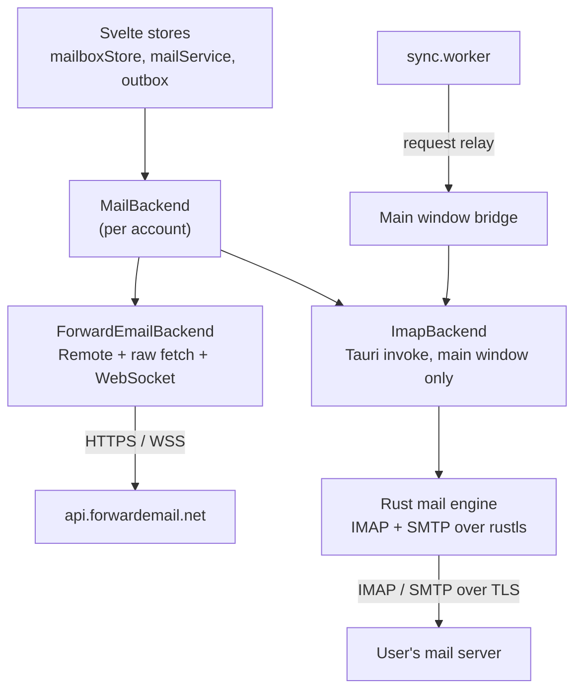
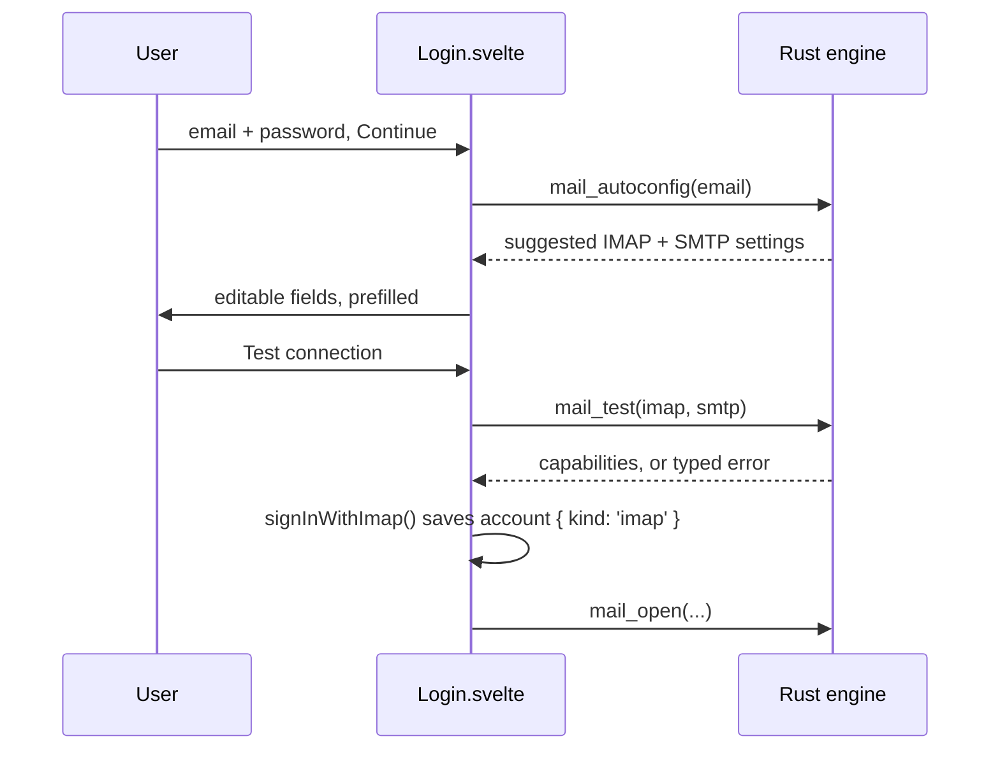
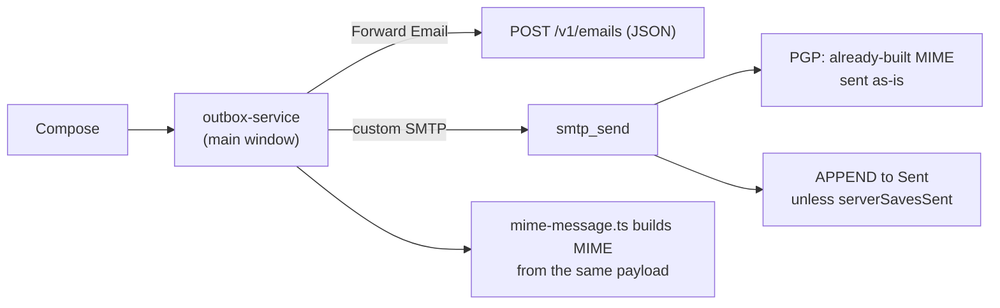

# Custom IMAP and SMTP Servers: Architecture

Status: proposed, revision 2 (2026-11-14). Nothing here is implemented yet.

This document describes how the client can sign in to any IMAP server, and how
any account can send through a custom SMTP server, without breaking the
Forward Email path the app is built around today.

It replaces the mail part of section 1 in
[v2 Roadmap Ideas](v2-roadmap-ideas.md). Where the two disagree, this document
is the current one (see [Differences from the roadmap](#differences-from-the-roadmap)).

## Where we start from

The client does not speak IMAP or SMTP today. Every request goes to the
Forward Email REST API (`/v1/folders`, `/v1/messages`, `/v1/emails`, and so on)
at `config.apiBase`, which is fixed at build time (`src/config.ts`). Live
updates come from the Forward Email WebSocket (`src/utils/websocket-client.js`).
Sending posts a JSON payload to `/v1/emails` and the server builds the MIME
message.

So supporting other providers is not a matter of changing server addresses. It
means adding a second kind of mail backend next to the REST API and choosing
one per account.

## Platform constraint

A browser cannot open raw TCP or TLS sockets, so the web PWA cannot talk to an
IMAP or SMTP server directly. Loosening the CSP would not change that, and the
CSP is treated as frozen anyway (see `docs/SECURITY.md`).

| Platform                              | Custom IMAP/SMTP                                                                                                  |
| ------------------------------------- | ----------------------------------------------------------------------------------------------------------------- |
| Tauri desktop (macOS, Windows, Linux) | Yes, where the email frame is isolated (see [Security](#security)). The engine runs in Rust.                      |
| Tauri mobile (iOS, Android)           | Later. Blocked on isolating the email frame on mobile. Background limits also apply.                              |
| Web PWA                               | No. The option is hidden. It would need a server-side bridge or JMAP, both out of scope.                          |
| Terminal client (`src/cli`)           | No, for now. It runs the app on Node with no Tauri. Options are listed under [Terminal client](#terminal-client). |

## Overview



## 1. The MailBackend seam

Stores call a backend chosen by the account rather than calling `Remote` or
`fetch` directly.

### Why a domain interface and not an action adapter

Demo mode swaps a whole backend in at the `Remote.request(action, params)`
level, and an IMAP adapter could do the same. That was considered and
rejected. The action parameters and responses are shaped like the REST API
(`page`, `lightweight`, `since_modseq`, the parsed `nodemailer` JSON), so an
IMAP adapter at that level would have to imitate the Forward Email server
inside the client.

To keep Phase 0 small, the interface covers mail only. Contacts, calendars,
Sieve and `/v1/account` stay on `Remote` and are switched off for IMAP
accounts by capability flags. They get their own interfaces if and when
CalDAV, CardDAV and ManageSieve arrive.

```ts
interface MailBackend {
  kind: 'forwardemail' | 'imap' | 'demo';
  capabilities: BackendCapabilities;

  listFolders(): Promise<Folder[]>;
  folderStatus(path: string): Promise<FolderStatus>;

  // Rows carry everything the list needs (see "List rows").
  listMessages(folder: string, opts: ListOptions): Promise<MessagePage>;
  changesSince(folder: string, token: ChangeToken): Promise<FolderChanges>;

  // Reading. Three calls, because whole-message fetch is not the default.
  getBody(id: string): Promise<MessageBody>; // text, html, inline parts, attachment list
  getAttachment(id: string, partId: string): Promise<Uint8Array>;
  getRaw(id: string): Promise<Uint8Array>; // PGP, Open Original, EML download

  setFlags(ids: string[], add: string[], remove: string[]): Promise<void>;
  move(ids: string[], dest: string): Promise<IdRemap>; // old id -> new id
  remove(ids: string[], opts: { permanent: boolean }): Promise<void>;
  saveDraft(draft: OutgoingMessage, replaceId?: string): Promise<string>;

  send(payload: OutgoingMessage): Promise<SendResult>;
  search(folder: string | null, query: SearchQuery): Promise<string[]>;
  subscribe(onEvent: (e: BackendEvent) => void): () => void;
}

interface ListOptions {
  cursor?: string; // opaque. A page number for the API, a UID bound for IMAP.
  limit: number;
  sort?: SortKey; // honoured only when capabilities.serverSort allows it
}

interface BackendCapabilities {
  calendar: boolean;
  contacts: boolean;
  filters: boolean;
  scheduledSend: boolean;
  serverPush: boolean;
  serverSavesSent: boolean;
  settingsSync: boolean; // settings and labels saved on the server
  labels: 'server' | 'keywords';
  serverSearch: boolean;
  serverSort: 'any' | 'arrival'; // 'arrival' means newest-first by UID only
  offlineReplay: 'service-worker' | 'foreground';
  quota: boolean;
}
```

UI code checks `capabilities`, never `kind`. `src/utils/api-capabilities.ts`
already caches a capability probe per `apiBase` and is the natural home for
this.

### Accounts

The account record in `src/utils/storage.js` (`Accounts`) gains a `kind`
field. Existing records without one are `forwardemail`.

```ts
type Account =
  | { kind: 'forwardemail'; email: string; aliasAuth?: string; apiKey?: string; smtp?: SmtpAccount }
  | { kind: 'imap'; email: string; imap: ImapAccount; smtp: SmtpAccount };

interface ImapAccount {
  host: string;
  port: number;
  security: 'tls' | 'starttls';
  username: string;
  password: string;
}
interface SmtpAccount {
  host: string;
  port: number;
  security: 'tls' | 'starttls';
  username: string;
  password: string;
}
```

The email address stays the account key everywhere (IndexedDB rows are keyed
`[account+id]`, and the account-scope seam in `src/utils/account-scope.ts`
works on it). One account per address: signing in to an address over IMAP
while it is already signed in as a Forward Email account is refused.

### Call sites that bypass Remote today

`Remote.request` is not the only way the app reaches the server. Every one of
these must move behind `ForwardEmailBackend` in Phase 0:

- `src/workers/sync.worker.ts`: raw `fetch` for message lists, details, prune
  checks and drafts
- `src/utils/sync-core.js`: mutation replay builds REST URLs from the stored
  `apiBase` (line 334 on)
- `public/sw-sync.js`: the service worker's copy of the same replay switch
- `src/utils/background-service.js`: hard-coded push-token URL (line 49)
- `pathOverride` callers that build message URLs by hand:
  `src/stores/mailboxActions.ts` (543, 972), `src/main.ts` (1547),
  `src/stores/filtersStore.ts` (264)
- `src/utils/network-status.js`: reachability probe against `apiBase`
- `src/utils/websocket-client.js`: realtime connection
- `src/stores/mailboxActions.ts`, `src/utils/mutation-queue.js`,
  `src/utils/sync-worker-client.js`: pass `apiBase` and auth into workers

Demo mode is a third `MailBackend` (`src/backends/demo.ts`). While the demo
is on, every account's backend is the demo one, so no mail call can reach a
real server. Reads come from the generated mailbox, read state is kept for
the session, and anything that would change the mailbox shows the demo toast
and fails. Calendar, contacts and sending are not backend calls and are still
answered by `interceptDemoRequest` in `src/utils/demo-mode.js`, which also
stays as a net under any mail request that goes through `Remote` directly
(drafts and the Sent copy). The store's checks that skip the IndexedDB cache
in the demo are unchanged.

### Workers and windows

Tauri's `invoke` only exists in a window. No worker in `src/workers/` uses it.
For an IMAP account the sync worker posts a request to the main window, which
calls Rust and posts the result back. The worker already has a `request`
message type to extend.

There is one Rust engine per process and several windows (`main` and
`compose-*`). The main window owns the engine:

- only the main window is granted the mail commands (see Security)
- engine events are emitted to the main window only
- compose windows already hand sends to the main window's outbox, so they
  need nothing new

Binary data crosses the bridge as binary. Rust returns it with
`tauri::ipc::Response`, and the main window transfers the `ArrayBuffer` to
the worker without a copy.

## 2. Rust mail engine

A new module (or workspace crate) under `src-tauri`.

| Concern    | Choice                          | Notes                                                                             |
| ---------- | ------------------------------- | --------------------------------------------------------------------------------- |
| IMAP       | `async-imap`, pending a spike   | See below                                                                         |
| SMTP       | own client in `mail/smtp.rs`    | Reuses the engine's address pinning and TLS rules; the webview builds the MIME    |
| TLS        | `rustls` via `tokio-rustls`     | Platform root store, no OpenSSL dependency, no option to accept a bad certificate |
| Autoconfig | `reqwest` (rustls) + SRV lookup | Runs in Rust, so the CSP is untouched                                             |
| Parsing    | none in Rust                    | Rust returns bytes. The existing JS parse path handles them.                      |

**The IMAP library is not settled.** Which extensions `async-imap` supports
(CONDSTORE, QRESYNC, MOVE, UIDPLUS, SORT) has not been checked. A spike before
Phase 1 must confirm each one against a real server, or pick another library
(`imap-next` is the alternative to evaluate). The change-tracking design
below has a fallback for servers without CONDSTORE, so the worst case is that
every server takes the slower path.

Parsing stays in JS so there is one parser and one normalization path
(`normalizeMessageForCache`) for every backend.

### Connections

Each IMAP account gets a small pool:

- one connection idling on INBOX (or using NOTIFY when the server supports it)
- one or two command connections for fetch, store, move and append

Providers cap connections per account (Gmail allows 15), so the pool has a
hard limit. Reconnects follow the existing backoff rules
(`src/utils/backoff.js`). The pool is closed on sign-out, on App Lock, and
when the account's settings change.

### Commands

Only two commands accept a host name. Everything else takes an account
handle that Rust issued.

```
mail_autoconfig(email)                      -> suggested settings
mail_test(imapSettings, smtpSettings)       -> capabilities or a typed error
mail_open(email, imapSettings, smtpSettings) -> handle; starts the pool
mail_close(handle)

imap_list(handle)                           -> folders, special-use, status
imap_rows(handle, folder, cursor, limit)    -> list rows
imap_changes(handle, folder, token)         -> new, changed and removed ids
imap_body(handle, id)                       -> headers + text parts (binary)
imap_part(handle, id, partId)               -> one MIME part with its headers
imap_raw(handle, id)                        -> whole message
imap_store(handle, ids, add, remove)
imap_move(handle, ids, dest)                -> id remap
imap_expunge(handle, ids)
imap_append(handle, folder, raw, flags)     -> id
imap_search(handle, folder, query)          -> ids
smtp_send(handle, payload | raw)            -> message id

event stream (main window): exists, expunge, flags, status, connection state
```

Errors are typed (`auth`, `tls`, `timeout`, `capability`, `server`) so the UI
can say something specific instead of "Request failed".

As built, the three change commands are `imap_store_many`, `imap_move_many`
and `imap_delete_many`. Each takes one folder and up to 250 UIDs.

### Changing many messages at once

The store changes a selection one message at a time and asks for all of them
together. One command per message cost about seven round trips each on a
connection that runs one command at a time, so a few dozen messages took most
of a minute.

- `ImapBackend` gathers the calls made for the same folder and the same
  change into one engine command (`together` in `src/backends/imap.ts`). Each
  caller still gets its own message's answer or the batch's error, so the
  optimistic update, the retry queue and the id remap are unchanged.
- A batch stays open until its turn on the connection. The first goes out at
  once; whatever is asked for while it is on the wire joins the next.
- A move of any size is six commands: read the Message-IDs, ask the
  destination for its next UID, move, open the destination, and read what
  arrived from that UID on. Old and new UIDs are paired by Message-ID
  (`pair_moved` in `src-tauri/src/mail/imap.rs`).
- The store hands an IMAP account 200 messages at a time
  (`changesAtOnce` in the capabilities) where the Forward Email API gets 8.

Changes replayed from the offline queue are still sent one at a time.

### Connections

An account has up to three connections to its IMAP server:

| Connection | Used for                                                          | Opened                     |
| ---------- | ----------------------------------------------------------------- | -------------------------- |
| Commands   | Folders, lists, searches, opening a message, flags, moves, drafts | At sign-in                 |
| Downloads  | An attachment (`imap_part`) or a whole message (`imap_raw`)       | The first time one is read |
| Watch      | IDLE on the inbox (`watch.rs`)                                    | When the app asks to watch |

Each runs one command at a time. A download can take minutes, and on a single
connection it held up every list, flag change and move behind it. Opening a
message stays on the commands connection: it reads at most 1 MB, or the text
parts of a larger message.

### Reading only what changed

On a server with CONDSTORE (RFC 7162), a folder has a change counter. A listed
page is stamped with `<uidValidity>:<counter>` as its rows' `modseq`
(`changeToken` in `src/backends/imap.ts`), and the sync pass saves it the way
it saves the Forward Email API's `since_modseq`.

- The next pass sends the token back. `imap_changes` opens the folder, and if
  the counter has not moved that one command is the whole pass.
- Otherwise it asks for the UIDs changed since (`UID FETCH 1:* (UID)
(CHANGEDSINCE n)`) and reads only those rows, wherever they are in the
  folder. Before, each pass read the newest page again and never saw a flag
  that changed further down.
- A pass saves the first token it sees, not the last, so a change made while
  it was paging is asked for again (`advanceModseq` in
  `src/workers/sync-pure.ts`).
- The token is ignored when the folder's UIDVALIDITY has changed, and on a
  server without CONDSTORE no token is made. Both fall back to listing the
  folder as before.
- The counter is kept as text. Gmail's are larger than a JavaScript number
  holds exactly.

Removed messages are not reported this way (that needs QRESYNC). They are
found as before, when the folder's pages are compared with the cache.

## 3. Mapping IMAP onto the current data model

### Message ids

`id = imap-<uidvalidity>-<uid>-<folder, base64url>`, scoped by account as
every row already is. The folder is encoded so the id is safe in a URL and as
an element id (`src/backends/imap-mapping.ts`).

- The id changes when a message moves. `moveMessage()` returns an old-to-new
  map. The IMAP library does not expose the server's COPYUID answer, so the
  engine reads the message's Message-ID before the move and searches for it
  in the destination afterwards. A message with no Message-ID gets no map:
  the next sync of the destination finds it and the old row is pruned.
- The map is applied in one place (`applyIdRemap` in `mailboxStore.ts`) to
  the cached row, its cached body, its search entry, the list on screen and
  the open message. The offline queue follows it for changes queued behind
  the move (`mutation-queue.js`).
- A UIDVALIDITY change drops that folder's cache and re-syncs it.

### List rows

The list needs `from`, `subject`, `date`, `flags`, `snippet`,
`has_attachment` and the threading headers (`src/types/message.ts`). One
`UID FETCH` returns almost all of it:

| Field                   | IMAP source                                                                   |
| ----------------------- | ----------------------------------------------------------------------------- |
| from, to, cc, subject   | `ENVELOPE`                                                                    |
| date                    | `INTERNALDATE` (arrival), with the `ENVELOPE` date kept for display           |
| flags, labels           | `FLAGS` (keywords are labels)                                                 |
| message_id, in_reply_to | `ENVELOPE`                                                                    |
| references              | `BODY.PEEK[HEADER.FIELDS (References)]`                                       |
| has_attachment          | `BODYSTRUCTURE`                                                               |
| size                    | `RFC822.SIZE`                                                                 |
| snippet                 | A second, partial fetch of the first text part (first 2 KB), batched per page |

Snippets fill in after the rows appear. Rows render with an empty snippet
first, as they already do while a body is loading. Threading stays on the
client (`src/utils/threading.ts`); there is no server `thread_id`, so IMAP
accounts always take the header-based path.

### Paging and sort order

IMAP has no pages and, without the SORT extension, no sort order other than
UID. So:

- `listMessages` takes an opaque cursor. For IMAP it is "UIDs below N".
- Default order is newest-first by UID, which is arrival order. That matches
  the default view.
- Other sorts (`src/utils/message-sort.ts`, `viewStore`) apply to the rows
  already cached. When the server has SORT, `serverSort` is `'any'` and the
  server does it. Otherwise the sort menu says it covers loaded messages only.

### Reading a message

Fetching the whole message every time is not acceptable: opening a mail with
a 25 MB attachment would download all of it, and body prefetch and search
indexing would multiply that.

- **Small messages** (`RFC822.SIZE` under 1 MB, which is most mail): fetch
  the whole message and parse it with the existing `parseRaw` path. One round
  trip, no new code path.
- **Large messages:** fetch the headers and the text and HTML parts named by
  `BODYSTRUCTURE`. Attachments and large inline images are listed from
  `BODYSTRUCTURE` and fetched one at a time with `getAttachment`.
- **Decoding a single part:** Rust returns the part's MIME headers followed
  by its body (`BODY[n.MIME]` + `BODY[n]`). That is a valid small message, so
  the same JS parser decodes the transfer encoding and charset. No second
  decoder.
- **PGP-encrypted messages** and **Open Original / EML download** use
  `getRaw`.
- Body prefetch (`docs/cache-indexing-architecture.md`) skips messages over
  the threshold for IMAP accounts.

### Changes, live updates and badges

| Today (REST API)          | IMAP account                                                                                                                                         |
| ------------------------- | ---------------------------------------------------------------------------------------------------------------------------------------------------- |
| WebSocket events          | IDLE on INBOX, NOTIFY where supported, otherwise periodic STATUS on other folders                                                                    |
| `since_modseq` list delta | `changesSince`: CONDSTORE/QRESYNC where supported, otherwise compare UID and flag ranges for the cached window. Feeds `src/utils/list-freshness.ts`. |
| Unread badge              | `STATUS (UNSEEN)` plus the local delta, as `src/stores/folder-unread.ts` does with `unseen_count` today                                              |

### Everything else

| Today (REST API)   | IMAP account                                                                                                                               |
| ------------------ | ------------------------------------------------------------------------------------------------------------------------------------------ |
| Labels on messages | IMAP keywords. Labels are already stored as lowercase keywords (`canonicalizeLabels`). Needs `PERMANENTFLAGS \*`; without it, labels hide. |
| Special folders    | SPECIAL-USE attributes. `mailboxStore` already checks `specialUse` first.                                                                  |
| Search             | Local FlexSearch unchanged. Server search uses IMAP `SEARCH`.                                                                              |
| Sent copy          | After an SMTP send, APPEND to Sent, unless `serverSavesSent` (Gmail does this itself). Per-account toggle with a provider default.         |
| Drafts             | APPEND to Drafts with `\Draft`, then delete the previous copy                                                                              |
| Delete             | Move to Trash. In Trash, `\Deleted` + `UID EXPUNGE`.                                                                                       |
| Quota              | QUOTA extension where supported, otherwise the storage meter hides                                                                         |

### Settings and labels

Settings, label names and label colors are saved on the Forward Email server
through `/v1/account` today (`src/stores/settingsStore.ts`, `fetchSettings`
and `updateSettings`, and the label create, update and delete actions). An
IMAP account has no such endpoint.

For accounts with `settingsSync: false`:

- settings and the label list are stored on the device only, per account, in
  the same local cache the store already reads at boot
- the save path skips the server call instead of failing
- the Settings page says they are kept on this device
- QR device pairing does not carry these accounts yet: it hands an account to
  the phone apps, which cannot use a custom server until mobile is supported.
  Settings shows a note in place of the pairing card

Labels then work as: keyword on the message (server), name and color (device).
A keyword seen on a message with no local label shows with its raw name, which
is what the "discovered" label flag in `src/types/account.ts` already models.

### Offline change queue

Queued changes are stored today with an `apiBase` and an `authHeader`, and
replayed as REST calls by `sync-core.js` and by the service worker
(`src/utils/mutation-queue.js`, line 146).

- The queued record stores the account and the operation. Replay in the app
  calls the account's backend.
- For Forward Email accounts the service worker keeps replaying in the
  background (`offlineReplay: 'service-worker'`). It still needs the URL and
  header, so the queue copies whatever the backend's `backgroundReplay()`
  returns onto the record. Only `ForwardEmailBackend` returns anything; a
  record for an IMAP or demo account carries neither.
- For IMAP accounts replay runs only while the app is open
  (`offlineReplay: 'foreground'`). `sw-sync.js` skips records it cannot run.
- Queued changes are replayed in order per account. When a `move` returns an
  id map, later queued changes for the old id are rewritten before they run.

### What IMAP accounts lose

| Feature                      | Why                                   | Later path                             |
| ---------------------------- | ------------------------------------- | -------------------------------------- |
| Calendar, Contacts           | Forward Email API only                | CalDAV / CardDAV                       |
| Filters                      | Sieve over the Forward Email API      | ManageSieve (RFC 5804)                 |
| Scheduled send               | The server holds the future `date`    | Local outbox timer while the app runs  |
| Push notifications           | Server push is Forward Email specific | None planned. IDLE while the app runs. |
| Settings on every device     | `/v1/account` only                    | QR pairing                             |
| Catch-all and alias features | Forward Email specific                | None                                   |

Each of these is a `capabilities` flag, so the tabs and settings hide rather
than fail.

## Security

The new commands let the webview open TLS connections to any host and send
mail. That is new attack surface, and it matters most where email content can
reach the Tauri call bridge.

### The email frame

The email frame is opaque-origin where the engine supports it. Where it does
not (mobile, and desktop on macOS 15 or Ubuntu 22.04 WebKit), it falls back
to `allow-scripts allow-same-origin` (`EmailIframe.svelte`, line 528, decided
by `src/utils/frame-isolation-probe.ts`). In that mode the sanitizer is the
only thing between a hostile email and `invoke`.

**Rule: custom IMAP/SMTP is offered only where the frame is opaque.** The
sign-in link and the Outgoing server setting check
`knownOpaqueFrameSupport()`. On engines that fail the probe they are hidden
with a one-line explanation. This is why mobile is "later": the mobile frame
has to be isolated first.

### Command surface

- **Build switch.** A release build refuses every mail command unless it was
  compiled with `FE_CUSTOM_MAIL=1` (`engine_enabled` in
  `src-tauri/src/mail/mod.rs`). The answer is fixed at compile time, so
  nothing in the webview can turn it on. Debug builds have it on. The app
  asks once through `mail_enabled` (`mailEngineEnabled` in
  `src/backends/engine-bridge.ts`) and offers neither the sign-in link nor
  the Outgoing server card when the answer is no. This is the flag phase 1
  ships behind: the release workflow does not set the variable yet.
- **Not enforced in Rust: the frame rule.** Whether the email frame is
  isolated is found out by the page (`frame-isolation-probe.ts`). On an
  engine where it is not isolated, script that escaped an email can do
  whatever the page can, including claiming the frame is isolated, so Rust
  cannot take the page's word for it. A check Rust can make by itself (a
  minimum WebKit version per platform) needs version numbers we do not have
  yet. Until then the build switch is what keeps the commands away from
  users who never asked for them.
- The mail commands are in their own capability file, granted to the `main`
  window only, not `compose-*`.
- Only `mail_test` and `mail_open` accept a host. All
  others take a handle. A handle cannot be pointed at a different server.
- `mail_test` and `mail_open` are rate limited in Rust and refuse loopback,
  link-local and private address ranges unless the user ticks "this is a
  server on my network" in the form.
- `mail_autoconfig` takes an address, not a host. It only fetches the URL
  shapes listed under
  sign-in, over HTTPS, with a size cap, a short timeout and no redirects to
  another host.
- No command returns a password. Rust log lines and typed errors go through
  the existing redaction (`src-tauri/src/redaction.rs`).
- TLS certificate errors are always fatal. There is no "accept anyway".
- STARTTLS is required to succeed before any credential is sent. A server
  that drops the capability is an error, not a downgrade.

### Credentials

IMAP and SMTP passwords use the storage the app already has, not a new one.

- They are fields on the account record, so they are covered by whatever
  covers `aliasAuth` today: the App Lock vault when App Lock is on
  (`src/utils/crypto-store.js`), otherwise the device seal on desktop
  (`src/utils/device-seal.ts`, key in the OS credential store).
- The webview passes them to Rust in `mail_open` at boot or unlock. Rust
  keeps them in memory for the life of the pool and drops them on
  `mail_close`, sign-out and App Lock.

This was chosen over one keychain item per password because that would have
put these passwords outside App Lock, broken QR device pairing (which reads
credentials from the account record, `src/utils/device-sync/bundle.ts`),
left Linux sessions without a Secret Service with no storage at all, and
added a macOS keychain prompt per account on every local rebuild.

The limits are the ones Forward Email credentials already have, documented in
`docs/SECURITY.md`: the device seal protects a copied profile directory, not
against code running as the same user.

### OAuth

Gmail and Microsoft 365 take no password over IMAP. The user signs in on the
provider's own page, in their own browser, and the app is handed tokens.

- **Flow.** Authorization code with PKCE for an app that cannot keep a secret
  (RFC 8252). The engine listens on a port on `127.0.0.1` that the system
  picks, opens the sign-in page, and accepts only the answer that carries the
  state value it made (`src-tauri/src/mail/oauth.rs`).
- **Fixed providers.** The webview names a provider (`google`, `microsoft`)
  and nothing else. The pages, the token server and the scopes are in Rust,
  so these commands cannot be pointed at another server. The token exchange
  uses the engine's own TLS connection code.
- **Client ids.** Read at build time from `FE_GOOGLE_OAUTH_CLIENT_ID`,
  `FE_GOOGLE_OAUTH_CLIENT_SECRET` and `FE_MICROSOFT_OAUTH_CLIENT_ID`. A
  provider without an id is not offered, so a build without them shows no
  sign-in buttons. The ids have to be registered by Forward Email. Google's
  `https://mail.google.com/` is a restricted scope: use beyond test users
  needs Google's verification and security assessment.
- **Tokens.** The refresh token is saved on the account record, where a
  password would be (`oauth: { provider, refreshToken }`). The access token
  is kept in memory only, renewed shortly before it runs out, and dropped
  when the app locks. A provider that replaces the refresh token on each use
  has the new one saved before the access token is used.
- **Signing in to mail.** `auth: 'xoauth2'` on the server settings: IMAP
  `AUTHENTICATE XOAUTH2` with the token on the command line, SMTP
  `AUTH XOAUTH2`. When a server refuses an expired token the bridge gets a
  new one and signs in again once.
- **Tests.** The whole flow runs against ImapKit's test sign-in page in
  `pnpm test:mail-engine`: approve, decline, time out, renew, a revoked
  refresh token, and IMAP and SMTP sign-in with the token. It has not been
  run against Google or Microsoft.

#### Open: where the Google secret lives

Not decided. To look at again before OAuth ships.

- **Today.** `FE_GOOGLE_OAUTH_CLIENT_SECRET` is compiled into the app, so
  anyone can read it out of the binary. Google says as much about "Desktop
  app" clients and still requires the value on the token request. What
  protects the sign-in is PKCE and the loopback redirect. Microsoft's public
  client has no secret at all.
- **What a copied secret allows.** Another app can show Forward Email's name
  on Google's consent page. It cannot get tokens for a user who has not
  approved it on that page.
- **Alternative: exchange through the Forward Email API.** The backend already
  has Google OAuth. The app would send the code and the PKCE verifier to the
  API, which holds the secret and returns the tokens. This keeps the secret
  off the device, and it means refresh tokens for the user's Gmail pass
  through Forward Email's servers on every sign-in and renewal. That breaks
  the rule under Credentials that nothing for a custom server is sent to the
  API, and the app stops working for these accounts when the API is down.
- **To find out.** Which scopes the backend's Google client is approved for
  (sign-in only, or `https://mail.google.com/`), whether it is a "Web" client
  (it cannot use a loopback redirect), and whether Google's restricted-scope
  review is easier to pass with one client type than the other.

## 4. Sign-in flow

Under the existing form in `src/svelte/Login.svelte`, a small link: **Use a
different mail server (IMAP)**. It renders only where the Security rule
allows.



### Fields

- Email and password
- IMAP host, port, security (SSL/TLS or STARTTLS; plaintext is not offered)
- SMTP host, port, security
- Username, defaulting to the email address, with an option to use a
  different SMTP username and password

### Autoconfig order

The form has a **Find settings for this address** button. Nothing is looked
up until the user presses it. The engine (`src-tauri/src/mail/autoconfig.rs`)
asks these in order and stops at the first that answers:

1. The domain's own file, `https://autoconfig.<domain>/mail/config-v1.1.xml`
2. Thunderbird's directory, `https://autoconfig.thunderbird.net/v1.1/<domain>`
3. The domain's MX record, to recognise a provider that hosts mail for other
   people's domains. A Forward Email exchanger is answered from a built-in
   entry with no request. Otherwise the directory is asked about the
   exchanger's domain (its last two labels, then its last three).
4. SRV records (`_imaps`, `_imap`, `_submissions`, `_submission`)

SRV is last, not second as first planned, because DNS answers are not signed
and a forged one could name any server. The form says where a suggestion came
from, and for one from DNS asks the user to check the server names.

Steps 2 and 3 tell Mozilla the mail domain, never the address. The form says
so, and the lookup can be skipped by typing the settings.

A suggested server without TLS or STARTTLS is dropped. When the lookup also
finds an outgoing server, sign-in tries it with the same password and saves it
only if that works, so most accounts can send without a visit to Settings.
When the incoming server is Gmail's or Microsoft's, the form points to the
provider's sign-in button, or to an app password when this build has none.

### Code

`signInWithImap` sits next to `signInWithAliasPassword` in
`src/utils/alias-sign-in.ts`. It runs the test, adds the account through
`Accounts`, and sets it active. Everything after that (account switching,
scope generation bumps, cache preload) goes through the existing
account-scope seam.

## 5. Custom SMTP in Settings

A per-account **Outgoing server** section in Settings:

- Forward Email accounts: "Forward Email (default)" or "Custom SMTP" with
  host, port, security, username, password and a Test button.
- IMAP accounts: SMTP is required and was set at sign-in. This section edits it.

### Send path

The branch lives inside `src/utils/outbox-service.js`, so undo-send, retries,
the offline queue and the optimistic Sent insert behave the same for every
transport.



Today the server builds the MIME message from JSON. For SMTP the webview
builds it from the same payload (`src/utils/mime-message.ts`, on the body
builder the PGP path already uses) and hands Rust the finished bytes, which
are also what is saved to Sent. When PGP has already produced the full
message (`src/utils/pgp-mime.ts`), it is sent unchanged. Rust speaks the
protocol only. It does not use `lettre`: a small client on the engine's own
connection code keeps the checked address pinned and the TLS rules in one
place.

Send-as identities (`src/utils/send-as.ts`) pick the transport of the account
the message is sent as, not of the active account.

Pictures: the editor inserts a picture as a `data:` address, which Gmail and
Outlook do not draw. `buildMimeMessage` moves each one into a part of its own
and points the HTML at it by Content-ID. Those parts, and forwarded parts the
HTML shows by `cid:`, go in a `multipart/related` part with the body. Files
stay in `multipart/mixed`. A draft keeps its pictures in the HTML so it opens
in the editor as it was saved.

After the Sent copy is saved, the outbox's `outbox-sent` event names the
account. No server event reports the copy for an IMAP account (only the inbox
is watched), so the main window reads Sent again when that account is the one
on screen (`sentNeedsReadingAgain`).

### Drafts from a compose window

A desktop compose window may not use the mail engine. For an account on a
custom IMAP server it writes the draft to the database both windows share and
sends `compose:save-draft` with the draft's id. The main window reads the
draft from the database, saves it, stores the server id on the row and
answers with `compose:draft-saved`. Removing a draft goes the same way
(`compose:remove-draft`). Neither event carries message content, and the main
window only ever removes a message that is in the Drafts folder. The list of
accounts this applies to is handed over in `compose:init` (`engineAccounts`),
since a compose window cannot always read the account list.

### Open question for Forward Email accounts

When a Forward Email account sends through a third-party SMTP server, nothing
saves a copy to Sent on the Forward Email side. The client would save it
through the API (`MessageCreate`) the same way the IMAP path appends it.
Confirm with the backend that this is right and that it does not conflict
with server-side Sent handling.

## Nothing goes to Forward Email

An account on a custom mail server is not a Forward Email account. Nothing of
it is tied to Forward Email or sent there unless the user sends it themselves.

| Where                    | Forward Email account                 | Account on a custom server                                                                            |
| ------------------------ | ------------------------------------- | ----------------------------------------------------------------------------------------------------- |
| API requests             | Authenticated as the account          | Refused in `Remote.request` before they leave the app                                                 |
| Report spam              | Forwarded to `abuse@forwardemail.net` | Moved to Junk only. Forwarded only to an address the user typed in, through their own outgoing server |
| Feedback                 | Sent through the API                  | An ordinary email from the user's address through their own outgoing server, when they press Send     |
| Invitation card          | Adds to the Forward Email calendar    | Shows the event, replies to the organizer by email, saves the `.ics` file. No calendar request        |
| Conversations            | Server `thread_id`                    | Message-ID, In-Reply-To and References from the message's own headers                                 |
| "Am I online" check      | Asks the Forward Email API            | Not asked when every signed-in account is on a custom server                                          |
| New release announcement | Forward Email socket                  | Not opened when every signed-in account is on a custom server. The desktop updater asks GitHub        |

The last two rows depend on every account being on a custom server
(`anyForwardEmailAccount()` in `src/backends/imap-account.ts`). With one
Forward Email account signed in as well, those calls are made for it.

Still Forward Email's, and left as they are: the links under About & Help,
which only open when clicked, and the diagnostics page's connectivity check,
which only runs when the user runs diagnostics.

### Settings for a custom server

Settings has a **Mail Server** section for these accounts, with the incoming
server (read only), the outgoing server and spam reporting. The cards that
only mean something for a Forward Email account are hidden: catch-all
passwords, delete account, and the Filters and Calendar sections.

## Terminal client

`src/cli` runs the same Svelte app on Node through TermDOM
(`docs/CLI.md`). There is no Tauri there, so `ImapBackend` cannot work as
designed, and the option is hidden. Two ways to add it later, neither planned:

- ship the Rust engine as a small sidecar binary the CLI talks to over stdio,
  which reuses the engine and its tests
- write a Node implementation of the engine commands, which means a second
  engine to maintain

The sidecar is the better fit if the terminal client needs this.

## What is built

Status on 2026-11-17, branch `feat/custom-imap-smtp`. Sign-in, lists, reading
and one SMTP send were checked by hand against Forward Email's own servers.
Everything else below has unit tests against a stand-in for the engine and
has not yet been run against a live server.

| Area              | State                                                                                                                      |
| ----------------- | -------------------------------------------------------------------------------------------------------------------------- |
| Sign-in           | Built. Settings looked up from the address or typed, or OAuth for Gmail and Microsoft 365 once client ids are registered.  |
| Folders and lists | Built. One connection per account.                                                                                         |
| Reading           | Built. Up to 1 MB whole. Above that, text and small inline parts only; an attachment is fetched when opened (`lean.rs`).   |
| Changes           | Built: flags, labels as keywords, move, delete, folders. A move returns the new id.                                        |
| Search            | Built: IMAP SEARCH for text, sender, recipient, subject, dates, unread, starred. "Has attachment" is a content-type guess. |
| Live new mail     | Built: IDLE on INBOX on a second connection (`watch.rs`), with a 60 second poll of the open folder behind it.              |
| Drafts            | Built: APPEND to Drafts, then the earlier copy is removed. A compose window hands the save to the main window.             |
| Sending           | Built: own SMTP client, MIME built in the webview, Sent copy by APPEND (skipped for Gmail hosts), then Sent is read again. |
| Settings, labels  | Built: kept on the device for an IMAP account.                                                                             |
| App Lock          | Built: locking signs every account out of the engine.                                                                      |
| Storage           | Built: the meter reads the server's QUOTA for the inbox, and hides where the server sets no limit. No billing link.        |
| Not built         | Mobile, CalDAV/CardDAV/ManageSieve, QR pairing of these accounts (waits for mobile), QRESYNC.                              |

### Tests against a real server

`pnpm test:mail-engine` starts [ImapKit](https://github.com/postalsys/imapkit),
an in-memory IMAP server that is strict about the RFCs, with an SMTP listener
and a control port, and runs the engine's own functions against it
(`src-tauri/src/mail/live.rs`). The mailboxes are in
`scripts/test-mail-engine.mjs` and are restored before each test. A plain
`cargo test` skips these tests. The `mail engine` job in `.github/workflows/ci.yml` runs them.

The test server's certificate is its own, so these tests connect with a
verifier that exists only in test builds. The engine itself only ever trusts
the operating system's certificate store.

## Phasing

| Phase | Scope                                                                                                                                                                                                            | Ships alone   |
| ----- | ---------------------------------------------------------------------------------------------------------------------------------------------------------------------------------------------------------------- | ------------- |
| 0     | `MailBackend` for mail only. Every call site listed above moves behind `ForwardEmailBackend`. Demo mode becomes a backend. Queue records stop storing URLs. No behaviour change; existing suites pass unchanged. | Yes           |
| Spike | Confirm the IMAP library's extension support. Run the engine against Forward Email's own IMAP and SMTP servers.                                                                                                  | Not shipped   |
| 1     | Desktop, isolated frame only: sign-in, autoconfig, folders, list rows, reading (all three fetch paths), flag changes, IDLE. Security section fully in place.                                                     | Behind a flag |
| 2     | Move, delete, labels, drafts, SMTP send, Sent append, offline queue replay, device-local settings, custom SMTP for Forward Email accounts                                                                        | Yes           |
| 3     | XOAUTH2 for Gmail and Microsoft                                                                                                                                                                                  | Yes           |
| 4     | Mobile: isolate the email frame first, then enable. Suspend and resume handling.                                                                                                                                 | Yes           |
| 5     | CalDAV, CardDAV, ManageSieve to bring back Calendar, Contacts and Filters                                                                                                                                        | Yes           |

## Testing

- **Differential test against Forward Email.** Forward Email runs IMAP and
  SMTP servers for the same mailboxes the API serves. Point both backends at
  one test alias and compare folders, rows, flags and bodies. Differences are
  either engine bugs or mapping gaps, and this is the cheapest way to find
  them. It is also the first target for the spike.
- **Rust engine:** integration tests against a Dovecot + Postfix container
  (or GreenMail) in CI, covering servers with and without CONDSTORE, a
  UIDVALIDITY change, MOVE without UIDPLUS, STARTTLS stripping, a bad
  certificate, and auth failures.
- **Store layer:** Vitest runs the same suites against a fake `MailBackend`
  configured with each capability set, so gating and mapping are tested
  without a server.
- **End to end:** the webview harness (`e2e-webview/`) drives the sign-in
  flow against the container. Happy path plus a bad password and a TLS
  failure.
- **Security:** a test that the mail commands are refused from a `compose-*`
  window, and that the sign-in link is absent when the frame probe reports
  no isolation.

## Differences from the roadmap

[v2 Roadmap Ideas](v2-roadmap-ideas.md) section 1 proposed the same
direction. This document changes four things:

| Topic                  | Roadmap                  | Here                                     | Why                                                                    |
| ---------------------- | ------------------------ | ---------------------------------------- | ---------------------------------------------------------------------- |
| Contacts and calendars | Part of `MailBackend`    | Left on `Remote`, gated by capability    | Keeps Phase 0 small. They need DAV, which is a separate piece of work. |
| Parsing                | `mail-parser` in Rust    | Existing JS parser                       | One parser and one normalization path for every backend                |
| Mobile                 | Same phase as desktop    | After the mobile email frame is isolated | See Security                                                           |
| JMAP                   | Phase D, for the web app | Not covered                              | Still the right answer for web. It would be a third `MailBackend`.     |

Kept from the roadmap: demo mode as a backend, and testing against Forward
Email's own IMAP and SMTP servers first.

## Risks

- **Id stability.** Every store and IndexedDB table assumes a stable server
  id. The id map has to reach cached rows, optimistic trackers and queued
  changes together, or moves will duplicate or lose messages in the cache.
- **Server variety.** Capabilities differ widely. Every optional extension
  needs a fallback, and the CI matrix needs at least one server without
  CONDSTORE and one without MOVE.
- **Library fit.** If the spike shows the IMAP library lacks an extension the
  design leans on, the fallback path becomes the main path and sync is
  slower. Decide before Phase 1.
- **Phase 0 size.** The list of call sites is long and `mailboxStore.ts` and
  `sync.worker.ts` are large. Land it in several changes, one call-site group
  at a time, each with the suites green.
- **Mobile background.** iOS suspends sockets, so IMAP accounts on iOS would
  only update in the foreground. This needs to be stated in the UI when
  mobile is enabled.
- **Scope creep.** Calendar, Contacts and Filters parity is the last phase on
  purpose. IMAP accounts launch without them, with the tabs hidden.
